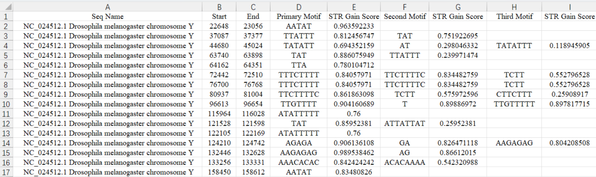
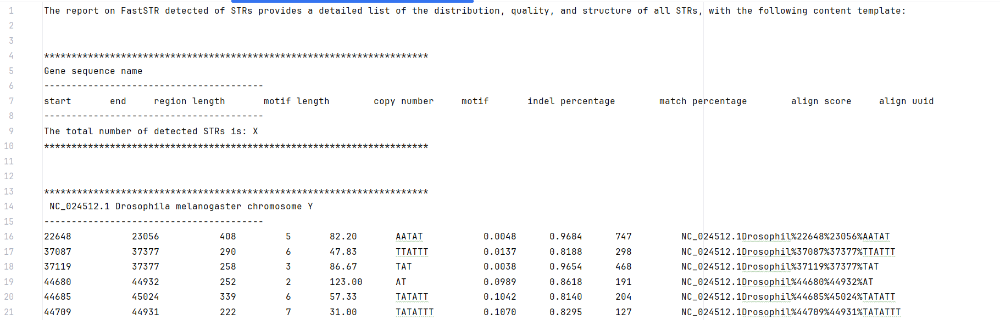
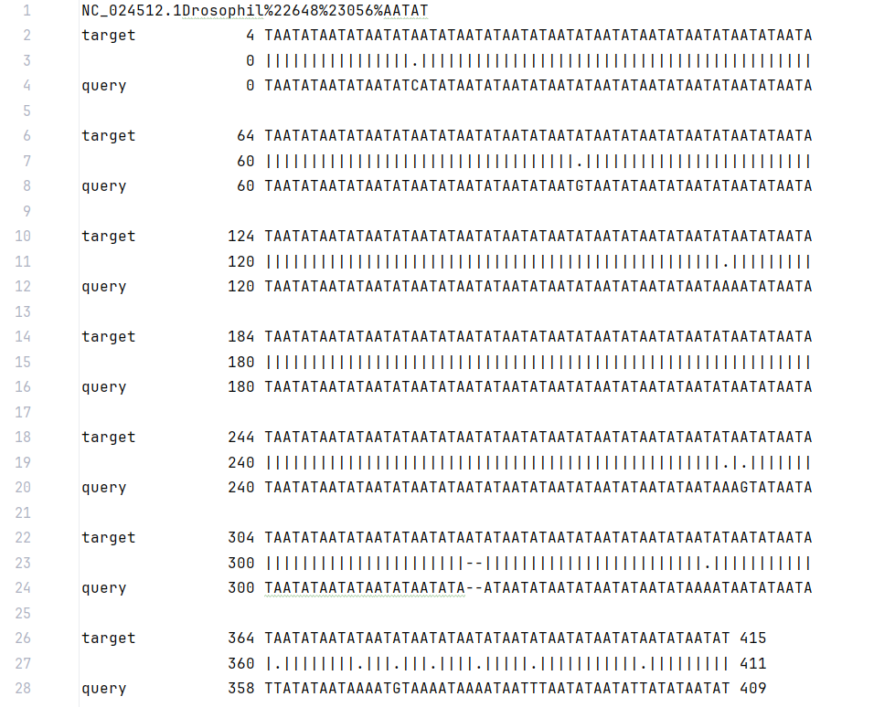

# FastSTR

FastSTR detects **short tandem repeats (STRs) in genome assemblies provided in FASTA format**. It identifies repeat locations and structures through candidate region detection, motif inference, sequence alignment, and interval merging, and reports motifs, copy numbers, and alignment quality metrics.

## Core algorithms

FastSTR uses a *de novo* detection approach that requires no predefined motif catalog and supports STRs with repeat units of 1–8 bp. Its core algorithms include:

- **Candidate region detection using density-based clustering:** Identical bases separated by fixed distances serve as anchors. Density-based clustering of these anchors identifies potential repeat regions.
- **Context-aware motif discovery:** N-gram statistics and Markov chains are used to infer candidate motifs from k-mer frequencies and base transition relationships.
- **Fast segmented global alignment:** For very long STRs, motif matches divide the sequence into segments. Unmatched segments are aligned using dynamic programming constrained by the motif.
- **STR interval merging and overlap resolution:** An interval-gain criterion based on sequence length and quality is used to select overlapping STR intervals with stronger support for their repeat structure.

## Installation

FastSTR requires **Python 3.9 or later**. Python **3.9–3.14** have been tested on Linux.

### Recommended installation

Install the stable release available on PyPI:

```bash
python3 -m pip install faststr
```

To install version 1.1.0 from PyPI after it has been published:

```bash
python3 -m pip install faststr==1.1.0
```

### Installation from source

Clone the repository and install the package:

```bash
git clone https://github.com/XL-BioGroup/FastSTR.git
cd FastSTR
python3 -m pip install .
```

### Check the installation

```bash
faststr --help
python3 -m pip show faststr
```

The first command lists the command-line options supported by the installed version. The second shows the installed package version.

### Optional: Cython acceleration

Version 1.1.0 includes five optional Cython extensions: `_anchors`, `_clusters`, `_motif_stats`, `_rpta`, and `_dbscan`. During installation from source, the installer attempts to build these extensions if the required build tools are available. Otherwise, FastSTR uses the corresponding Python implementations, which preserve functionality but may run more slowly.

To **require compilation** of the native extensions, complete the source installation above, then run the following command from the project directory on Linux or macOS:

```bash
FASTSTR_BUILD_EXTENSIONS=1 python3 -m pip install --force-reinstall --no-deps --no-cache-dir .
```

This requires a C compiler and Python development headers. Installation fails if compilation fails. Set `FASTSTR_BUILD_EXTENSIONS=0` to skip extension compilation explicitly; the default is `auto`. SIMD alignment is provided by the separate Parasail dependency. Installation without a compiler depends on the availability of a precompiled Parasail package for your platform.

To check that all five native extensions were installed, run the following command **from outside the source directory**:

```bash
python3 -c "from faststr import _anchors, _clusters, _motif_stats, _rpta, _dbscan; print('All five native accelerators loaded')"
```

If you use Conda, you can create a Python environment and run the same `pip` installation commands within it. A separate Conda package for FastSTR is not required.

Installation typically takes about **2–5 minutes** on a Linux workstation with a working network connection and readily available dependencies. The actual time depends on downloads and compilation.

## Quick start

### 1. Analyze a FASTA file

Create an output directory in the current directory:

```bash
mkdir -p results
```

Analyze the input FASTA with the default quality thresholds, `normal` alignment mode, and eight worker processes:

```bash
faststr --normal --default genome.fa -f results -p 8
```

FastSTR writes an STR interval summary, detailed records, sequence alignments, and a log file to `results`.

### 2. Run the example provided in the repository

If you cloned the source from GitHub, run the following commands from the repository root:

```bash
mkdir -p results
faststr --strict --default example/NC_024512.1.fna -f results -p 8
```

List the output files:

```bash
ls -lh results/
```

### 3. Customize detection thresholds

For example, use `loose` alignment mode, set the minimum match percentage to 75% and the maximum insertion/deletion (indel) percentage to 20%, and lower the minimum alignment score to 40:

```bash
faststr --loose --default --p-match 75 --p-indel 20 --score 40 genome.fa -f results -p 8
```

Here, `--loose` selects an alignment scoring preset, and `--default` supplies the default quality thresholds. Explicit parameter values override the corresponding defaults, regardless of argument order.

### 4. Analyze a specific genomic region

Use `--start` and `--end` to specify the region to analyze. For example, to analyze positions 1,000,000 through 2,000,000 in the input sequence:

```bash
faststr --normal --default genome.fa --start 1000000 --end 2000000 -f results -p 8
```

These positions are 1-based and inclusive. If the FASTA contains multiple sequences, the same range is applied to each sequence.

**Command syntax:**

```bash
faststr {--strict | --normal | --loose} --default <input.fa> [options]
```

The input FASTA, exactly one of the three alignment modes, and `--default` are required.

## Command-line options

### Alignment modes

| Mode | Match | Mismatch | Gap open | Gap extend |
| --- | ---: | ---: | ---: | ---: |
| `--loose` | 2 | 7 | 7 | 7 |
| `--normal` | 2 | 5 | 7 | 3 |
| `--strict` | 2 | 3 | 5 | 1 |

Mismatch and gap penalties are shown as positive magnitudes; FastSTR applies them as negative scores during alignment.

### General and advanced options

| Option | Default | Description |
| --- | ---: | --- |
| `sequence` | Required | Path to the input FASTA file |
| `--strict` / `--normal` / `--loose` | Choose one | Alignment scoring mode |
| `--default` | Required | Use the default quality thresholds |
| `-f`, `--out_dir` | `.` | Output directory |
| `-p`, `--processes` | `1` | Number of worker processes |
| `-l`, `--read_length` | `15000` | Sequence processing window length in bp |
| `-o`, `--overlap` | `1000` | Overlap between adjacent windows in bp |
| `-s`, `--start` | `1` | Start position in each input sequence |
| `-e`, `--end` | `0` | End position; `0` means the end of the sequence |
| `-b`, `--beta` | `0.045` | Motif coverage threshold used when aligning very long sequences |
| `--insertion-share` | `0.5` | Fraction of total indels attributed to insertions when calculating gain for overlapping intervals; range 0–1 |
| `--match` | Mode preset | Match reward |
| `--mismatch` | Mode preset | Mismatch penalty magnitude |
| `--gap-open`, `--gap_open` | Mode preset | Gap opening penalty magnitude |
| `--gap-extend`, `--gap_extend` | Mode preset | Gap extension penalty magnitude |
| `--p-match`, `--p_match` | `80` | Minimum match percentage; range 0–100 |
| `--p-indel`, `--p_indel` | `15` | Maximum indel percentage; range 0–100 |
| `--score` | `50` | Minimum alignment score |

## Output files and interpretation

FastSTR produces four types of output files. Filenames include the input file stem and the **scoring parameters and quality thresholds used for the run**.

| File suffix | Contents | Typical use |
| --- | --- | --- |
| `_summary.csv` | Merged STR intervals, primary and alternative motifs, and their gain scores | Interval-level summaries and inspection |
| `_detailed.dat` | Coordinates, motif, copy number, quality metrics, and alignment identifier for each STR call | Detailed structural analysis and filtering |
| `_aligned.dat` | Sequence alignments for the STR calls | Inspection of interrupted repeats, mismatches, and indels |
| `.log` | Input and output information, processing stages, timings, and run status | Troubleshooting and runtime tracking |

### Interpreting the example results

The following examples use actual output from `example/NC_024512.1.fna` and show how to find an STR call from the interval summary and inspect its alignment. These results were generated with `--strict --default -p 8`.

#### 1. `_summary.csv`: inspect detected repeat regions



Records in this file represent merged STR intervals. The main fields are:

| Field | Meaning |
| --- | --- |
| `Seq Name` | FASTA sequence, chromosome, or contig name |
| `Start`, `End` | Start and end positions of the merged STR interval |
| `Primary Motif` | Primary repeat unit for the interval |
| `STR Gain Score` | Interval gain score for the motif immediately preceding this column |
| `Second Motif`, `Third Motif` | Additional candidate motifs in the same interval, if present |

For example, the first record covers positions **22,648–23,056** on the *Drosophila melanogaster* Y chromosome, `NC_024512.1`. The primary motif is **`AATAT`**, with a gain score of approximately **0.9636**.

A merged interval can contain multiple STR calls. For the interval **37,087–37,377**, `_summary.csv` reports both `TTATTT` and `TAT` as candidate motifs. Thus, **a row in `_summary.csv` does not necessarily correspond to a single row in `_detailed.dat`**.

#### 2. `_detailed.dat`: inspect the structure and quality of each STR



This file contains one record per STR call, with fields including `start`, `end`, `region length`, `motif length`, `copy number`, `motif`, `indel percentage`, `match percentage`, `align score`, and `align uuid`.

For the first `AATAT` repeat described above:

| Metric | Example value |
| --- | --- |
| Chromosome | `NC_024512.1` (*D. melanogaster* Y chromosome) |
| Start and end positions | `22648–23056` |
| STR region length | `408 bp` |
| Motif | `AATAT` (5 bp) |
| Estimated copy number | `82.20` |
| Match percentage | `0.9684` (96.84%) |
| Indel percentage | `0.0048` (0.48%) |
| Alignment score | `747` |

The high match fraction and low indel fraction indicate that the sequence closely matches the inferred tandem repeat structure. Although the output fields are named `match percentage` and `indel percentage`, their values are reported as fractions between 0 and 1.

The `align uuid` field links each call to its alignment. For this locus, the identifier is:

```text
NC_024512.1Drosophil%22648%23056%AATAT
```

Search for this identifier in `_aligned.dat` to find the corresponding alignment.

#### 3. `_aligned.dat`: inspect sequence alignments



Each alignment is labeled with its `align uuid` and displays the `target` and `query` sequences, with alignment markers between them:

- `|`: matching bases.
- `.`: mismatched bases.
- `-`: a gap in an aligned sequence, representing an insertion or deletion relative to the other sequence.

These alignments show the continuity of repeat units and the distribution of local mismatches and indels. For STRs with inconsistent boundaries or complex structures, inspect the alignment together with the quality metrics in `_detailed.dat`.

**How the three result files relate:** Find the repeat region in `_summary.csv`, inspect its individual STR calls in `_detailed.dat`, then use `align uuid` to locate the base-level alignment in `_aligned.dat`.

> `STR Gain Score` is a score used to select overlapping intervals. It is **not the probability that a motif is correct**, and it differs from the `align score` reported in `_detailed.dat`.

#### 4. `.log`: check run status, timings, and result counts

The log records input size, runtime parameters, CPU and worker process configuration, and the time spent in each stage. On completion, it reports the number of STR calls and merged regions, lists the output paths, and records `Program completed`. Errors during processing are logged with the failed stage, error message, and traceback to aid troubleshooting.

## Performance reference

The following historical full-genome comparison used FastSTR with **72 worker processes** on the human T2T-CHM13v2.0 assembly and TRF with its default parameters:

| Dataset | Tool | Runtime |
| --- | --- | ---: |
| Human T2T-CHM13v2.0 | TRF | 66,666 s (18 h 31 min 6 s) |
| Human T2T-CHM13v2.0 | FastSTR | 529.549 s (8 min 49.549 s) |

The FastSTR timing comes from the historical `faststr_memopt` run with normal/default parameters, measured from `Program started` to `Program completed`. It excludes Python imports. The current release includes these optimizations, but its full T2T runtime has not been remeasured. The historical records do not establish identical hardware or timing methods for both tools.

## Citation

If you use FastSTR in your research, please consider citing:

Liao, X. et al. Efficient identification of short tandem repeats via context-aware motif discovery and ultra-fast sequence alignment. bioRxiv https://doi.org/10.1101/2025.11.25.690584 (2025).

## License

The package metadata specifies the **MIT License**. The full license text should also be included in the repository before release.
